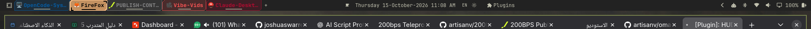
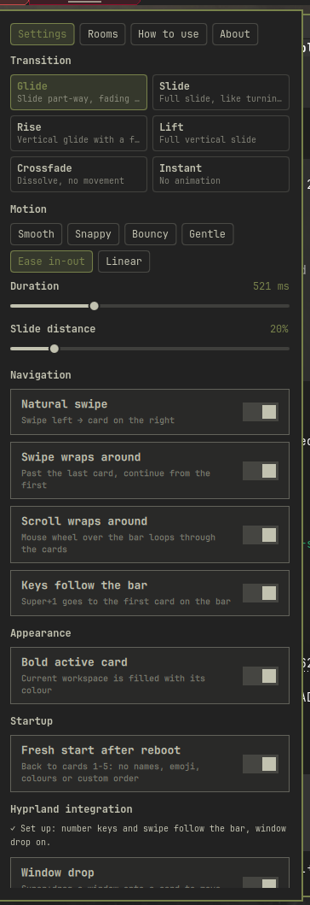
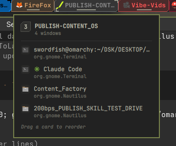
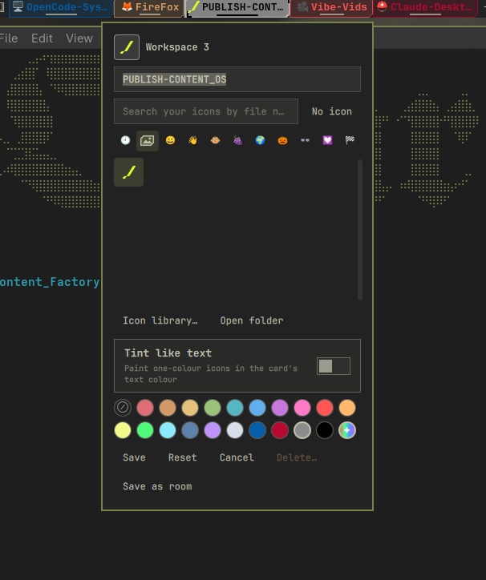
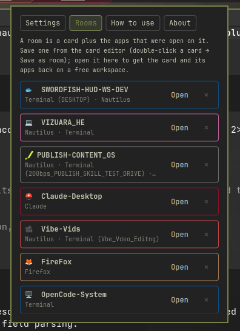
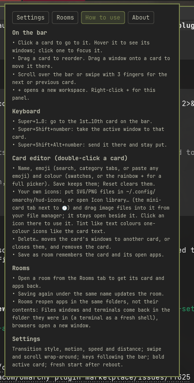
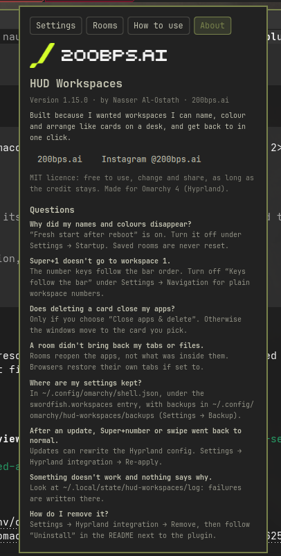

# HUD Workspaces



## Screenshots













A workspace bar widget for the [Omarchy](https://omarchy.org/) shell: HUD-style workspace
cards you can reorder, name, colour and decorate with emoji or your own icons, with transitions that follow
the order you see on the bar.

Version 1.16.3 · requires Omarchy 4 (Hyprland Lua config) · `jq`, `hyprctl` and `python3` on `PATH`.

**Tested with:** Omarchy 4.0.0 alpha · Hyprland 0.56.2 · Quickshell 0.3 · Qt 6.11. Other
Hyprland versions may work; the widget warns in Settings when yours differs from the
tested one, and problems are written to `~/.local/state/hud-workspaces/log`.

---

## Install

From git (recommended):

```bash
omarchy plugin add https://github.com/artisanv/omarchy-hud-workspaces.git --enable
```

Or from a release zip / folder:

1. Copy this folder to `~/.config/omarchy/plugins/swordfish.workspaces/`
   (the folder name and the `id` in `manifest.json` must both be `swordfish.workspaces`).
2. Check the download and make the scripts executable:
   ```bash
   sha256sum -c swordfish-hud-workspaces-v1.16.3.zip.sha256   # next to the zip
   chmod +x ~/.config/omarchy/plugins/swordfish.workspaces/ws-*
   ```
3. Put the widget on the bar in place of the stock workspaces widget:
   ```bash
   omarchy bar put swordfish.workspaces
   ```
4. Restart the shell so it loads cleanly:
   ```bash
   omarchy restart shell
   ```
5. Optional, but recommended: right-click **+** → **Settings** → **Hyprland integration** →
   **Install**, so Super+number and the 3-finger swipe follow the bar and windows can be
   dropped on cards. See [Hyprland integration](#hyprland-integration).

---

## Using it

| Action | What it does |
|---|---|
| **Click** a card | Go to that workspace. |
| **Drag** a card | Reorder the bar. Cards step aside to show where it lands; the order is saved. |
| **Double-click** or **right-click** a card | Open the card editor: name, emoji or your own icon, colour, save as room, delete. |
| **Hover** a card | Room preview: the windows on that workspace (click one to focus it). |
| **Scroll** over the bar | Step through the cards in bar order. Wraps around by default. |
| **3-finger swipe** | Step through the cards in bar order (after the setup below). |
| **Click +** | Open the next free workspace (brings back a deleted one first). |
| **Right-click +** | Open the panel: **Settings**, **Rooms**, **How to use** and **About** tabs. |
| **Super+1…0** | Go to the 1st…10th card on the bar (after the setup below). |
| **Super+Shift+number** | Take the active window to that card. **+Alt**: send it without following. |
| Drag a window onto a card | Move that window to the workspace (after the setup below). |

### Card editor (double-click a card)

- **Name**: shown on the card, which widens to fit (long names end in "…").
  Leave it empty to show the number again.
- **Emoji**: search the full emoji list ("music", "code", "fire"…), or jump by category
  with the tabs above the grid (🕘 recently used, smileys, people, animals, food,
  travel, activities, objects, symbols, flags). Enter in the search box picks the first
  match. Paste any emoji into the search box to use it as-is, including skin tones and
  emoji newer than the list. **No emoji** removes it.
- **Your own icons** (the mini-card tab next to 🕘): use your own image instead of an emoji. See
  [Custom icons](#custom-icons) below. A card shows an icon *or* an emoji: picking one
  clears the other.
- **Colour**: tints the card and replaces the accent colour while that workspace is
  active. ⊘ follows the theme. Pick one of 16 swatches, or the rainbow **+** for the full
  picker: saturation/brightness square, hue strip and a hex field (`#1e90ff`). Custom
  colours you save are kept next to the swatches.
- **Save** (or Enter in the name field) keeps the changes; **Cancel**, Escape or a click
  outside discards them; **Reset** clears name, emoji and colour.
- **Save as room** keeps the changes and saves the card with its open apps as a
  [room](#rooms).

On a vertical bar, cards stay compact and show the emoji, icon or number only.

### Custom icons

Your icons live in **`~/.config/omarchy/hud-icons/`**: SVG (best: sharp at any size),
PNG, JPG or WebP. The folder sits outside the plugin, so updating or reinstalling keeps
your icons. In the card editor they're in the **Your icons** tab: the little cut-corner
card with a picture in it, next to 🕘.

**Adding icons: the Icon library.** In the Your icons tab, click **Icon library…**. The
editor makes way for a normal window that stays open, so you can put it next to your
file manager:

- **Drag image files into it** from Files/Nautilus (or any file manager). They're copied
  into your icon folder and highlighted. Several at once is fine.
- **Add images…** opens the file chooser instead.
- **Open folder** opens the icon folder itself.
- **Click an icon** to use it: you're back in the card editor with that icon picked and
  your other unsaved edits kept. **Back to editor** (or Escape) returns without picking.

(The card editor itself closes when you click anywhere outside it, which is why
dragging goes into the library window rather than the editor.)

New or deleted files show up right away, no refresh needed. Adding a file whose name is
already taken by a different image saves it as `name-2.svg` and so on, so nothing gets
overwritten.

**Using them**: double-click a card → Your icons tab → click an icon (or type part of its
file name in the search box and press Enter). Hover an icon to see its file name.
**Tint like text** paints the icon in the card's text colour, so a one-colour
(silhouette) icon follows the card colour and the active-card contrast like the number
does. Leave it off for full-colour icons.

Square icons with little padding look best; they're drawn at emoji size. The card and
any [rooms](#rooms) store only the file name, so renaming or deleting a file makes the
card fall back to its name or number. Use another folder with the `iconDir` setting, e.g.
`omarchy bar set swordfish.workspaces iconDir ~/Pictures/icons`.

### Deleting a workspace (editor → Delete…)

- **Empty workspace**: confirm with **Delete**, and the card is removed.
- **Workspace with windows**: each window is listed with a destination menu: any other
  card, or **＋ New workspace**. With several windows, **Move all to** sets them all at
  once. Then:
  - **Move & delete** moves the windows (without pulling you along) and removes the card.
  - **Close apps & delete** closes the apps the polite way (like Super+W), after a
    second **Yes, close them** confirmation. Apps with unsaved work may ask to save
    first. The card is removed as soon as the last app is gone, even if the editor
    was closed in the meantime (for example by clicking an app's save dialog). If
    apps are still open after a few seconds, the editor says so: close or save them
    yourself and the card still goes once they're closed (for up to 3 minutes), or
    **Move them instead**. **Cancel** there keeps the workspace.
- If you were on the deleted workspace, you land on the card the windows went to
  (or a neighbouring card).

A deleted workspace's name, emoji and colour are cleared. It stays off the bar
unless something is on it (for example Super+3 recreates workspace 3, and its card
shows while it's in use). **+** brings deleted workspaces back for good.

## Rooms

A room is a card (name, emoji, colour) plus the apps that were open on it, so you can
rebuild a workspace in one click, for example after the fresh start on reboot.

- **Save**: double-click a card → **Save as room**. Saving again under the same name
  updates the room.
- **Open**: right-click **+** → **Rooms** → **Open**. The room gets the next free workspace,
  its card appears at the end of the bar, you switch to it and its apps start there.
- **Delete**: **✕** next to the room.

Rooms reopen the apps in the same folders, not their contents:

- **Files (Nautilus)** opens a new window **at the folder each window was showing**
  (read from Nautilus itself, one folder per window; for a window with several tabs, the
  tab matching its title).
- **Terminal** comes back as a fresh shell **in the folder it was in**. Commands that
  were running (an editor, Claude Code, a server) and the scrollback are not brought
  back. GNOME Terminal windows all share one process, so the folder comes from the
  window title (`user@host:~/path`, the default), or, when a program has changed the
  title, from the shell sitting in a folder that a Files window in the same room shows,
  the usual "open a terminal here" setup.
- **Browser** opens a new window (with its own session restore, if set).
- **Flatpak apps** are reopened with `flatpak run`.

Example: a workspace with Files in `~/Projects/site` and a terminal opened there, saved
as a room, reopens as Files at `~/Projects/site` plus a terminal in `~/Projects/site`.
Rooms are never cleared by the fresh start on reboot.

## Profiles

A profile is a whole deck: several cards, in bar order, each with its name, emoji or icon,
colour and apps, saved as one thing. Opening it gives you exactly that bar back.

- **Save**: right-click **+** → **Profiles**. Pick the cards to include (cards with apps or
  a label start picked; click a card to toggle it), type a name and press **Save**. Saving
  again under the same name updates the profile.
- **Open**: **Open** next to the profile. Its cards take the bar, in the saved order, and
  their apps start on them; you land on the first one. Empty cards that aren't in the
  profile are removed. If other cards still have apps open, you're asked first:
  - **Close apps**: those apps are asked to close (as with Super+W; unsaved work prompts
    as usual) and each card goes once its last window is gone.
  - **Keep them**: those cards stay, after the profile's cards.
- **One at a time, never twice**: the profile on the bar is marked **● Active**. While all
  its cards are on the bar its button says **On** and is locked, so it can't be opened a
  second time. Its cards stay its own even if you rename or recolour them. If you delete
  one of its cards, the button says **Restore** and brings back only that card and its
  apps. Open is also locked while a profile is still starting its apps. If two identical
  cards are ever on the bar, the profile refuses to open and tells you which one to delete
  instead of guessing. Opening a different profile replaces the active one, even when its
  cards are already on the bar (they are reused, never copied); saving a profile makes it
  the active one.
- **Delete**: **✕** next to the profile.

Example: cards 🧑‍💻 Code (Files + terminal in `~/Projects/site`), 🎵 Music (Spotify) and
💬 Chat (Signal), saved as "Work". After a reboot, open "Work" and the bar is exactly
those three cards with those apps, nothing else.

Each card in a profile is stored like a room, so the same rules apply to what comes back
(folders yes, contents no). A profile holds up to 10 cards; the workspaces it uses are
the free ones (no windows) from 1 upward, and Super+number follows the bar, so Super+1 is
the profile's first card. Profiles are never cleared by the fresh start on reboot.

### Transition settings (right-click +)

**Transition**: how one workspace gives way to the next.

| Transition | Look |
|---|---|
| Glide | Slides part of the way while fading through. |
| Slide | Full slide, like turning pages. |
| Rise | Vertical glide with a fade. |
| Lift | Full vertical slide. |
| Crossfade | Dissolve, no movement. |
| Instant | No animation. |

**Motion**: the easing curve, combinable with any transition.
Smooth · Snappy · Bouncy (overshoots and settles) · Gentle · Ease in-out · Linear.

**Duration**: 100–1500 ms, slider (the value shows while you drag; it saves on release).

**Slide distance**: 5–100 % of the screen, for Glide and Rise.

**Navigation**
- *Natural swipe*: on, swipe left goes to the card on the right (like natural scrolling).
  Off, swipe right goes to the card on the right.
- *Swipe wraps around*: past the last card, continue from the first.
- *Scroll wraps around*: the same for the mouse wheel over the bar.

**Appearance**
- *Bold active card* (on by default): the card of the workspace you're on is filled
  solid with its colour (or the theme accent), with high-contrast text, a thicker edge
  and a soft glow. Off: the original subtle outline.

**Startup**
- *Fresh start after reboot* (on by default): after every reboot or power-off the
  cards go back to default: workspaces 1–5, in order, numbered, with no names, emoji,
  colours or deleted workspaces. Restarting the shell or reloading Hyprland doesn't
  count; only a new boot does. Transition and swipe settings are always kept.
  Turn it off to keep your cards across reboots.

**Preview** hops to a neighbouring card and back so you can see the result.
Every change applies immediately and survives restarts.

Slides always move the way you travel along the bar: going to a card on the right
enters from the right. (Hyprland on its own slides by workspace *number*, which runs
backwards once the bar is reordered; this plugin corrects that for clicks, scrolling and
swipes. Super+number shortcuts can't know the bar order, so they slide by number.)

---

## Hyprland integration

Three things need Hyprland's side, not just the bar:

- **Number keys**: stock Omarchy binds Super+number to workspace numbers, which stop
  matching the bar once cards are reordered or deleted. With the integration, Super+1 is
  the first card on the bar (Shift: move the window there; Shift+Alt: move it without
  following). Past the last card a key falls back to that workspace number. **Keys follow
  the bar** (Settings → Navigation) switches this off without uninstalling.
- **Touchpad swipe**: the 3-finger swipe steps through cards in bar order instead of by
  number. Direction and wrap-around are in Settings. The switch happens when the swipe
  completes, with your chosen transition.
- **Window drop** (optional): Super+drag a window onto a card to move it there. Only real
  window drags count: dragging a tab, text or a file inside a window up to the bar does
  nothing.

**Install** it from right-click **+** → **Settings** → **Hyprland integration**, or from a
terminal:

```bash
~/.config/omarchy/plugins/swordfish.workspaces/ws-setup install            # all three
~/.config/omarchy/plugins/swordfish.workspaces/ws-setup install --no-drop  # without window drop
~/.config/omarchy/plugins/swordfish.workspaces/ws-setup status             # what's set up (JSON)
~/.config/omarchy/plugins/swordfish.workspaces/ws-setup remove             # stock behaviour back
```

What it changes, all under `~/.config/hypr/` and all undone by **Remove**:

- writes `hud_workspaces.lua` (generated; don't edit it),
- adds one marked block at the end of `hyprland.lua`:
  ```lua
  -- >>> HUD Workspaces (managed by ws-setup) >>>
  pcall(require, "hypr.hud_workspaces")
  -- <<< HUD Workspaces <<<
  ```
- comments out the stock `hl.gesture({ … action = "workspace" })` line in `input.lua`
  inside the same kind of markers (two swipes on the same fingers would fight).

Every file is backed up first to `~/.config/omarchy/hud-workspaces/backups/` (last 20
kept), and if Hyprland reports config errors afterwards the backups are put back
automatically. If you pasted the snippets from an earlier version of this README into
`bindings.lua` / `input.lua`, **Install** finds them and moves them into the managed
file. If you delete the plugin without running **Remove**, the generated file notices and
binds nothing, so your keys and swipe go back to stock instead of breaking.

**After an Omarchy update**: updates can rewrite the Hyprland config. The widget checks
a few seconds after the shell starts and, if the integration was changed, sends a
notification and shows **Re-apply** in Settings. To have it re-applied automatically
after every update instead, install with `--auto-reapply` (adds
`~/.config/omarchy/hooks/post-update.d/hud-workspaces.hook`; it edits your Hyprland
config without asking, which is why it's opt-in).

---

## Settings reference

Everything is stored on the widget's entry in `~/.config/omarchy/shell.json` and can also
be set from a terminal, e.g. `omarchy bar set swordfish.workspaces transition slide`.

| Key | Values | Default |
|---|---|---|
| `order` | bar order, JSON list of workspace numbers | `[1,2,3,4,5]` |
| `labels` | per-workspace `name` / `emoji` or `icon` + `iconTint` / `color` (JSON) | none |
| `iconDir` | folder for [custom icons](#custom-icons) | `~/.config/omarchy/hud-icons` |
| `hidden` | deleted workspaces, JSON list of numbers | `[]` |
| `transition` | `glide` `slide` `verticalglide` `vertical` `fade` `none` | `glide` |
| `transitionCurve` | `smooth` `snappy` `bouncy` `gentle` `easeinout` `linear` | `smooth` |
| `transitionDuration` | 100–1500 (ms) | `400` |
| `transitionDistance` | 5–100 (%) | `20` |
| `swipeNatural` | `true` / `false` | `true` |
| `wrapSwipe` | `true` / `false` | `false` |
| `wrapScroll` | `true` / `false` | `true` |
| `keysFollowBar` | `true` / `false`: Super+number by bar position | `true` |
| `activeStyle` | `solid` / `outline` | `solid` |
| `resetOnBoot` | `true` / `false`: default cards after each reboot | `true` |
| `rooms` | saved rooms (JSON list), see [Rooms](#rooms) | `[]` |
| `profiles` | saved decks (JSON list of `{name, rooms}`), see [Profiles](#profiles) | `[]` |
| `activeProfile` | internal: the profile on the bar and its workspaces (JSON) | |
| `recentEmoji` | recently used emoji (JSON list, newest first) | `[]` |
| `recentColors` | recently used custom colours (JSON list) | `[]` |
| `lastBoot` | internal: the boot the widget last saw | |

Numbers and booleans need `--json`, e.g. `omarchy bar set swordfish.workspaces transitionDuration 600 --json`.

Stored data is bounded when read: labels only for workspaces 1–10 with short strings, at
most 50 rooms of 30 apps, 20 profiles of 10 cards, 32 recent emoji/colours. All writes to `shell.json` go through
one queue, so two quick edits can't overwrite each other.

## Backup and restore

Omarchy updates rewrite `~/.config/omarchy/shell.json`, and `omarchy refresh shell` resets
it, which can wipe every name, colour, room and preference in one go. So after every
change the widget copies its settings to `~/.config/omarchy/hud-workspaces/backups/`
(`latest.json`, plus one file per day for the last 14 days that had cards or rooms).

- **Restore backup** (Settings → Backup) brings back the newest backup that has your cards
  or rooms. The widget also notices when your rooms have vanished but a backup has them,
  and says so in a notification and in Settings.
- **Export** writes `~/hud-workspaces-settings-<date>.json`; **Import…** applies one (for
  another machine, or before reinstalling). Only known settings are imported, each
  type-checked.

From a terminal: `ws-settings backup | export [file] | import <file> | restore | status`.

## Privacy

Rooms and profiles hold folder paths and window titles, so HUD Workspaces keeps them
private to your user:

- **Nothing on command lines.** Command-line arguments can be read by every local user
  (`ps`), so the widget saves its settings inside the shell (no `omarchy bar set`
  processes), hands rooms to `ws-room` on stdin, and `ws-room` builds JSON with `jq`
  reading stdin and talks to Hyprland over its socket instead of `hyprctl` arguments.
  `ws-settings import` edits `shell.json` directly from a private temp file.
- **Private files.** Backups (`~/.config/omarchy/hud-workspaces/backups/`, folder `700`,
  files `600`), exports and the log (`~/.local/state/hud-workspaces/`) are only
  readable by you; backups and logs made by older versions are fixed on the next write.
  `shell.json` keeps the permissions it has.
- **Text is only text.** Window titles, app names and card, room and profile names are
  always shown as plain text, so a title containing HTML (for example an `` tag
  pointing at a web address) is displayed as written and never loads anything.
- **What stays visible:** an app a room starts runs with its normal command line (for
  example `nautilus --new-window ~/Projects/site`), exactly as if you had opened it
  yourself from a launcher.

## `ws-step`

The script that does the switching, usable from keybindings too:

```
ws-step next|prev [--wrap]   neighbouring card in bar order
ws-step swipe left|right     what the touchpad gestures call
ws-step goto <id>            a specific workspace, sliding from its side of the bar
ws-step slot <n>             the n-th card (Super+n)
ws-step move <n>             move the active window to the n-th card and follow it
ws-step move-silent <n>      same, without following
ws-step apply                re-apply the saved transition
ws-step preview              hop to a neighbour and back
```

Example: Super+Alt+Right / Left through the bar in `~/.config/hypr/bindings.lua`
(`o.bind` runs a command string):

```lua
local ws_step = os.getenv("HOME") .. "/.config/omarchy/plugins/swordfish.workspaces/ws-step"
o.bind("SUPER + ALT + RIGHT", "Next card", ws_step .. " next")
o.bind("SUPER + ALT + LEFT", "Previous card", ws_step .. " prev")
```

---

## `ws-room`

Captures and reopens rooms; the widget calls it, but it works from a terminal too:

```
ws-room capture <workspace>          print the apps on a workspace as JSON
ws-room launch <workspace> [-]       switch there and start the apps given on stdin
ws-room capture-deck <ws>...         capture several workspaces: {"<ws>": [apps]}
ws-room launch-deck [-]              open several rooms at once, from stdin: [{"ws": 3, "apps": [...]}]
ws-room check [-]                    show what each app would be started with (runs nothing)
```

The JSON is read as one line from stdin (`-`, the default), e.g.
`ws-room check - < room.json`. Passing it as an argument still works, but then it is
visible to other users in `ps`.

Rooms are stored commands, so they're handled as data: each app is saved as an argument
list (never a shell string), every argument is quoted when it starts, the program must
exist, and `flatpak run` only takes a plain app id. Rooms saved by versions before 1.15
are converted when opened (split into words, nothing executed). Treat a `rooms` value
from someone else like a script: look at it with `ws-room check` before importing it.

## Troubleshooting

- **Workspaces missing from the bar**: the `id` in `manifest.json` must be
  `swordfish.workspaces`, matching the bar entry. Check
  `journalctl --user -b | grep "Plugin widget"` for load errors.
- **Changes to the plugin files don't show, or the widget acts oddly after editing**:
  the shell's live reload doesn't always recover. Run `omarchy restart shell`.
- **Transitions reset after `hyprctl reload`**: the widget re-applies them automatically;
  if not, run `ws-step apply`.
- **Emoji look monochrome or missing**: install `noto-fonts-emoji`.
- **Super+number or swipe went back to stock after an update**: Settings → Hyprland
  integration → **Re-apply** (or `ws-setup reapply`). Check **Keys follow the bar** is on.
- **Something silently doesn't work**: look at `~/.local/state/hud-workspaces/log`.
  ws-step, ws-room, ws-setup, ws-settings and the widget all write failures there
  (Hyprland refusing a call, a room app that couldn't start, a bar API that changed).
- **Settings gone after an update**: Settings → Backup → **Restore backup**.
- **A room's app opened on another workspace**: the room waits 20 seconds for each app's
  window; a slower app lands wherever you are when it finally opens.

## Uninstall

1. Undo the Hyprland integration: Settings → Hyprland integration → **Remove**, or
   `~/.config/omarchy/plugins/swordfish.workspaces/ws-setup remove`.
2. Put the stock widget back: in `~/.config/omarchy/shell.json`, change the bar entry
   `"id": "swordfish.workspaces"` to `"id": "omarchy.workspaces"` (its other keys can go).
   Export your settings first if you might come back.
3. Delete `~/.config/omarchy/plugins/swordfish.workspaces/` and run `omarchy restart shell`.
   Optionally delete `~/.config/omarchy/hud-workspaces/` (backups), `~/.config/omarchy/hud-icons/`
   (your icons) and `~/.local/state/hud-workspaces/` (log).

## About

**HUD Workspaces** by **Nasser Al-Ostath · [200bps.ai](https://200bps.ai)** ·
Instagram [@200bps.ai](https://instagram.com/200bps.ai)

Built because I wanted workspaces I can name, colour and arrange like cards on a desk,
and get back to in one click.

Released under the MIT licence (see `LICENSE`): free to use, change and share, as long as
the credit stays. The 200bps.ai logo in `assets/` is the author's brand and is not covered by
the MIT licence; keep it with this plugin, or remove it from your own fork.

---

## Changelog

- **1.16.3**: Security fix from the marketplace review: window titles in the hover preview
  (and every other text in the widget) are shown as plain text. Qt's default would read a
  title containing an HTML `` tag as rich text and fetch the image from its web
  address when the preview opened. A test checks every text item.

- **1.16.2**: Only the active profile is marked **● Active** and locked. Before, any profile
  whose cards were all on the bar (for example after saving a smaller profile from the same
  bar) was also marked Active and locked, so you couldn't switch back to it. Switching
  reuses those cards, so nothing is duplicated.

- **1.16.1**: `python3` is listed as a requirement (it carries room commands to Hyprland's
  socket). Without it, rooms still open through `hyprctl`, with a note in the log that
  their commands are then visible in `ps`.

- **1.16.0**: **Privacy fixes** from the marketplace review: room data (folders, titles,
  commands) no longer appears in process arguments. Settings are written inside the shell,
  rooms reach `ws-room` on stdin, `ws-room` uses Hyprland's socket, and `ws-settings
  import` writes `shell.json` itself. Backups, exports and logs are private (`700`/`600`),
  existing ones are fixed. New [Privacy](#privacy) section.
  **Profiles**: save a whole deck of cards (names, emoji/icons, colours, apps,
  order) as one profile and reopen exactly that bar in one click, closing or keeping the
  other cards' apps. One profile is active at a time and can't be opened twice (locked while
  on the bar or starting; Restore brings back deleted cards; identical copies are refused). New Profiles tab. `ws-room capture-deck` / `launch-deck`; launching
  several rooms at once shares one window watcher, so two rooms with the same app (e.g. two
  terminals) don't take each other's windows. Profiles are part of backups and export.

- **1.15.0**: Hardening and update-proofing, from an external review.
  - Rooms store argument lists, not shell strings; every argument is quoted at launch,
    programs must exist, flatpak ids are allowlisted; old rooms are converted without
    running anything. `ws-room check` shows what a room would start.
  - One Lua escaper for everything sent to Hyprland; stored labels, rooms and recent lists
    are bounded; all `shell.json` writes go through one queue.
  - **Hyprland integration** managed by `ws-setup` (install / remove / status / reapply) as
    one generated file and one marked block, with backups and automatic rollback on
    config errors; Settings shows its state and offers **Re-apply** after updates;
    optional post-update hook. Window drop only reacts to real window drags.
  - **Backup and restore** of all settings (automatic after each change), export/import,
    and a notice when an update seems to have wiped them.
  - Failures are logged to `~/.local/state/hud-workspaces/log` instead of hidden; the widget
    fails soft if the bar's internals change; warns on an untested Hyprland version.
  - Rooms reopen Electron apps (e.g. Signal) correctly.

- **1.14.0**: Rooms reopen Files (Nautilus) windows at the folder they showed, and find a
  terminal's folder even when a program has changed its title. Window drop no longer moves a window when you drag a tab, text or a file
  inside it up to the bar (1.15 moves this into [Hyprland integration](#hyprland-integration)).
  [Custom icons](#custom-icons): use your own SVG/PNG images instead of an
  emoji on cards and rooms, with optional tinting. An **Icon library** window to drag
  image files into (or add them with the file chooser); the icon list updates live.

- **1.13.0**: Card editor: emoji category tabs and a **Recently used** tab, paste any emoji
  (skin tones, newest emoji), 16 swatches, a full colour picker (saturation/brightness,
  hue, hex) and recent custom colours.
- **1.12.3**: Rooms keep a GNOME Terminal's folder even when several terminal windows are
  open (read from the window title).
- **1.12.2**: Author credit is now Nasser Al-Ostath (About tab, manifest, LICENSE, README).
- **1.12.1**: The 200bps.ai logo heads the **About** tab (light or dark version to match
  the theme; click it to open the site).
- **1.12.0**: Saved rooms (card editor → **Save as room**, open from the new **Rooms** tab).
  Super+number follows the bar order (`ws-step slot|move|move-silent`, setting
  **Keys follow the bar**). The right-click **+** panel gets **Rooms**, **How to use** and
  **About** tabs. Fix: switching off **Natural swipe** (or any on/off setting read by
  `ws-step`) was ignored. MIT `LICENSE` added.
- **1.11.0**: **Close apps & delete** finishes on its own: the card is removed once the
  last app closes, even if the editor was dismissed (e.g. by a save dialog) — no
  second delete needed.
- **1.10.0**: Bold active card: the current workspace's card is filled solid with its
  colour and contrasting text (toggle under Appearance).
- **1.9.0**: Fresh start after reboot: cards return to 1–5 with no names, emoji,
  colours, custom order or deletions (toggle in the transition panel; transitions kept).
- **1.8.0**: Delete a workspace from the card editor: empty ones go straight away; for
  ones with windows, move each window to another card or a new workspace, or close the
  apps (with confirmation). Right-click a card to open the editor.
- **1.7.0**: Six transitions (Glide, Slide, Rise, Lift, Crossfade, Instant), six motion
  curves, duration slider (ms) and slide-distance slider; swipe direction and
  wrap-around toggles in the panel; this guide. Fixes the 1.6 speed presets, which were
  inverted (your previous choice is kept as the duration it actually ran at).
- **1.6.1**: Scroll wraps around; swipe direction reversed.
- **1.6.0**: Transition picker (right-click +); slides follow the bar direction.
- **1.5.0**: 3-finger swipe follows the bar order (`ws-step`).
- **1.4.0**: Card editor you can type in; full emoji picker; colour emoji on cards.
- **1.3.0**: Names shown on cards (cards widen to fit).
- **1.2.0**: Name / emoji / colour per workspace; drag-reorder overlap fixed.
- **1.1.1**: Stable baseline: plugin id fixed, rename repaired.
